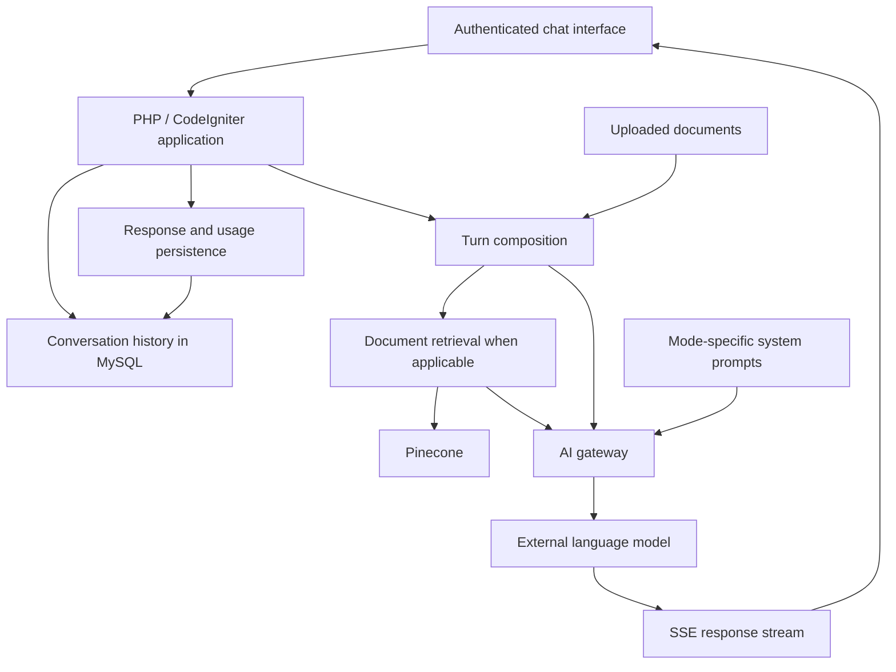

# Lex Immobilia AI

**An AI assistant for legal and real estate professionals.**

**Role:** Main developer - **Source code:** private organizational repository

I developed most of the application, connecting a PHP backend and conversational interface with document retrieval, external AI models and persistent conversation history. I collaborated with other contributors on the project; the contribution estimate is not a measured share of commits or lines of code.

## The problem

Legal and real estate professionals need to work with questions, supporting documents and the context of an ongoing matter. A useful assistant needs more than a single model request: it must preserve conversations, retrieve relevant material, support different workflows and make responses available progressively.

## What the application does

- Provides an authenticated chat interface organized around professional topics.
- Supports different response modes, with model selection managed on the server.
- Retrieves relevant document passages from Pinecone for supported topics and modes.
- Incorporates uploaded documents into the conversation workflow.
- Streams responses to the browser using server-sent events (SSE).
- Stores conversation history and reconstructs context for subsequent turns.
- Records model usage, token counts and costs returned by the AI gateway.

## My contribution

As the main developer, I worked across application architecture, backend development, the chat interface and AI integrations. My work brought these parts together into a professional workflow: access the application, select a topic and mode, ask a question, receive a streamed response and resume the conversation later.

The project is collaborative. The approximately 90% estimate describes my overall development contribution; it does not imply sole authorship of every feature, document or specialist instruction.

## Architecture

**Backend:** PHP, CodeIgniter 3, MySQL  
**Interface:** JavaScript, AdminLTE, Bootstrap  
**AI integration:** Requesty gateway, Pinecone, retrieval-augmented generation, SSE  
**Document pipeline:** offline Python tooling for corpus ingestion

## Engineering decisions

### Separate retrieval from request handling

Document retrieval and turn composition live in dedicated services rather than being embedded entirely in the chat controller. This gives uploaded documents, retrieved passages and the user's original question a single composition point.

### Keep application records separate from the document corpus

MySQL stores application data, conversations and usage. Pinecone provides document retrieval. The two stores serve different responsibilities rather than duplicating the document corpus in the relational database.

### Make retrieval conditional

Retrieval applies to supported topics and modes. Relevant passages are selected using topic filtering and a relevance threshold. When the initial search finds no suitable passages, a fallback can reformulate the question and retry. If no relevant material is found, the composed request explicitly identifies that absence.

### Distinguish documents from external references

Uploaded documents describe the user's specific case; retrieved material supplies external reference context. Turn composition includes instructions that distinguish these roles so that retrieval instructions do not inadvertently exclude the user's own document.

### Design persistence around streaming

The application starts saving a new conversation and user turn when the first response text arrives. This avoids creating a conversation if the model fails before producing text and makes the conversation identifier available while the answer is still streaming. The assistant response is subsequently stored, including partial text when generation is stopped.

### Keep model selection on the server

The interface sends a response mode. The application resolves the configured model and loads the corresponding system prompt, keeping provider-specific selection out of the browser.

## What this project demonstrates

- Integration of AI capabilities into an application with authentication and persistent state.
- Backend orchestration across relational storage, vector retrieval and external APIs.
- Streaming interface behavior coordinated with database persistence.
- Document-aware prompt composition and handling of missing retrieval results.
- Development across backend, frontend and integration boundaries.

## Scope

This case study describes implemented application behavior, not a guarantee of legal correctness. Response quality depends on source coverage, retrieval and model behavior. No adoption, revenue, accuracy or performance figures are claimed here.

The source code remains in a private organizational repository. This public overview contains no credentials, customer conversations, private documents or proprietary prompt text.

---

**Lorenzo Picchi** · [GitHub](https://github.com/Piccios) · [LinkedIn](https://www.linkedin.com/in/lorenzopicchi/)
